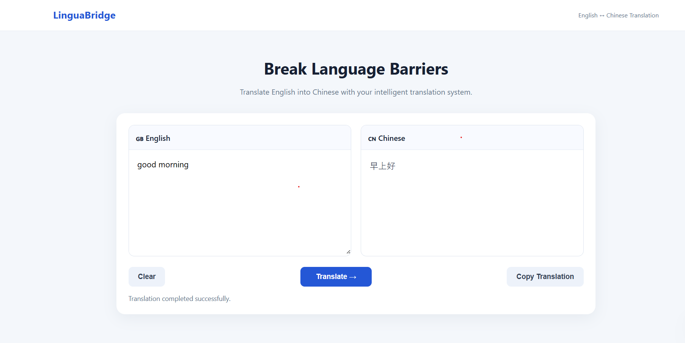

# English to Chinese Translator 🇬🇧 🇨🇳

A Python-based English-to-Chinese translation application using Natural Language Processing (NLP), translation rules, and cultural adaptations. The project includes a Flask-based web interface for users to translate English text into Chinese.

## 📌 Project Overview

The English to Chinese Translator is designed to provide English-to-Chinese translations using a rule-based translation system.

It incorporates translation rules, character voices, cultural adaptations, and emotional tones to support context-aware translation.

## ✨ Features

- **English-to-Chinese Translation:** Translates English text into Chinese.
- **Rule-Based Translation:** Uses a collection of translation rules stored in CSV format.
- **Cultural Adaptation:** Supports cultural adjustments in translations.
- **Character Voices:** Includes different character profiles for translation.
- **Emotional Tones:** Supports different emotional tone settings.
- **Web Interface:** Provides a browser-based interface using Flask.
- **Translation History:** Includes a history endpoint.
- **Statistics:** Includes a statistics endpoint.

## 🛠️ Technologies Used

- Python
- Natural Language Processing (NLP)
- Flask
- Pandas
- NumPy
- spaCy
- Regular Expressions
- JSON and CSV

## 📂 Project Structure

```text
english_chinese_translator/
│
├── config/
├── data/
│   └── processed/
├── data_processing/
├── datasets/
├── models/
├── templates/
│   └── index.html
├── utils/
│
├── main.py
├── final_web_app.py
├── translation_rules.csv
├── character_voices.json
├── cultural_adaptations.json
├── requirements.txt
├── requirements_simple.txt
└── README.md
```

## ⚙️ Installation

### 1. Clone the Repository

```bash
git clone https://github.com/Linaaftab/-english-chinese-translator.git
```

### 2. Navigate to the Project Directory

```bash
cd -english-chinese-translator
```

### 3. Create a Virtual Environment

```bash
python -m venv venv
```

### 4. Activate the Virtual Environment

Windows:

```powershell
venv\Scripts\activate
```

### 5. Install Dependencies

```bash
pip install -r requirements.txt
```

## 🚀 Run the Application

Start the Flask web application:

```bash
python final_web_app.py
```

Open your browser and visit:

```text
http://127.0.0.1:5000/
```

## 🌐 Application Endpoints

| Endpoint | Method | Purpose |
|---|---|---|
| `/` | GET | Main application page |
| `/translate` | POST | Translation |
| `/history` | GET | Translation history |
| `/stats` | GET | Translation statistics |
| `/test` | GET | Testing endpoint |

## 📊 Dataset

The project includes translation datasets in CSV format, including enhanced OpenSubtitles-derived datasets.

Two large original OpenSubtitles language files are excluded from this GitHub repository because of their size.

## 📦 Requirements

Project dependencies are listed in `requirements.txt`.

- pandas
- numpy
- regex
- tqdm
- spaCy
- Flask

## 👩‍💻 Author

**Linaaftab**

GitHub: https://github.com/Linaaftab

## 📄 License

Please refer to the dataset license files and source dataset terms before redistributing dataset content.---

## Application Preview

Here is a preview of the LinguaBridge translation interface:


---

## System Architecture

```mermaid
flowchart TD
    A["User Interface<br/>templates/index.html"] -->|HTTP JSON Request| B["Flask Backend<br/>final_web_app.py"]

    B --> C["Translation Route<br/>/translate"]
    C --> D["EnglishChineseTranslator<br/>main.py"]

    D --> E["Translation Rules<br/>translation_rules.csv"]
    D --> F["Cultural Adaptations"]
    D --> G["Character Voices"]
    D --> H["Emotional Tone Patterns"]

    I["Training Dataset<br/>OpenSubtitles CSV"] --> D

    D --> J["Chinese Translation"]
    J --> K["JSON Response"]
    K --> A

    B --> L["Translation History<br/>Last 50 Records"]
    B --> M["Statistics & Testing"]

    style A fill:#dbeafe,stroke:#2563eb,color:#1e3a8a
    style B fill:#ede9fe,stroke:#7c3aed,color:#4c1d95
    style D fill:#dcfce7,stroke:#16a34a,color:#14532d
    style J fill:#fef3c7,stroke:#d97706,color:#78350f
